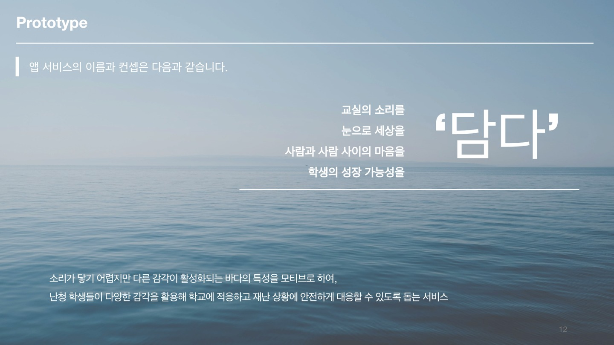
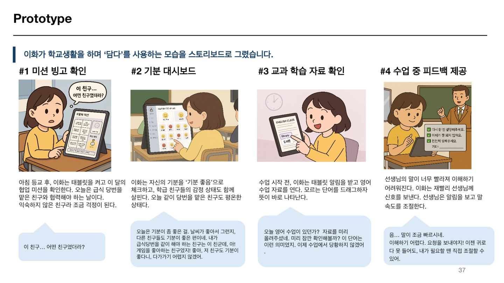

# 담다 — 난청 초등 고학년 대상 학교생활 지원 서비스

난청 초등학생이 학교의 학습·소통·교우관계·안전 상황에 참여할 수 있도록 돕는 서비스 설계 프로젝트입니다.

| 항목 | 내용 |
| --- | --- |
| 활동 | 2025학년도 1학기 소프트웨어창의설계 / TELOS 소프트웨어 트랙 |
| 수상 | 제6회 SW연계융합전공 TELOS트랙 공모전 장려상 |
| 수상일 | 2025년 6월 11일 |
| 팀 | SUM(e) — 우승아, 이예영, 김가은, 김혜원 |
| 우승아 역할 | **팀장 · 기획 · 프로토타입 개발** |

## 문제와 접근

문헌조사와 교육 현장 인터뷰를 바탕으로 난청 학생의 학교생활에서 발생하는 어려움을 분석했습니다. 학생·교사·보건교사의 사용 맥락을 나누고, 사용자 흐름과 화면을 설계한 뒤 프로토타입으로 구체화했습니다.

- 소통과 학습 참여를 지원하는 화면 및 사용자 흐름 설계
- 난청 학생과 건청 학생, 교사와 보건교사를 고려한 역할별 기능 기획
- 긴급 상황 알림과 학교생활 지원 기능 설계

## 증빙 자료

- [서비스 핵심 장표 — 10쪽](서비스_핵심장표.pdf)
- [장려상 상장 — 학번 가림](장려상_학번가림.pdf)
- [클래스 다이어그램](docs/diagrams/class.png)
- [기능별 시퀀스 다이어그램 — 10쪽](docs/diagrams/sequence.pdf)
- [미션빙고 시퀀스 다이어그램](docs/diagrams/mission-bingo.png)

