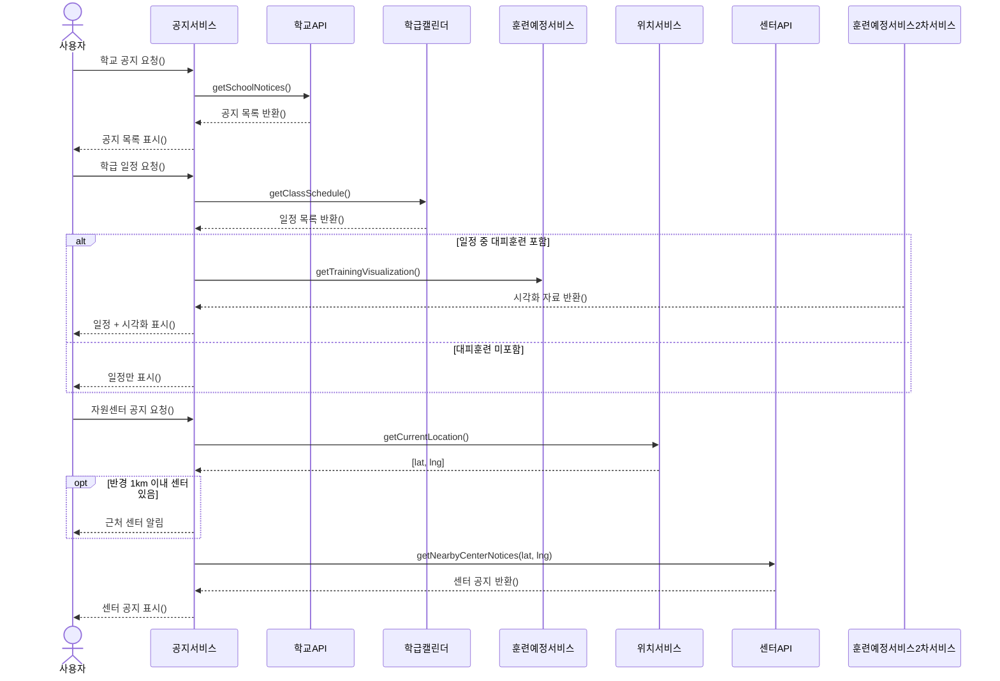

# 학교·학급·자원센터 공지

[Mermaid 코드](sequence-06-notices.mmd) · [원본](../sequence.pdf#page=6) · [목록](README.md)

보관 이미지의 요소와 관계를 Mermaid로 복원했습니다. 배치는 자동으로 재구성됩니다.

원본에는 시각화 요청을 받는 참여자와 응답을 보내는 참여자가 서로 다르게 그려져 있습니다. 이를 임의로 수정하지 않고 별도 참여자로 유지했습니다. 오른쪽 참여자 명칭은 흐릿하여 원본과 함께 확인해 주세요.

