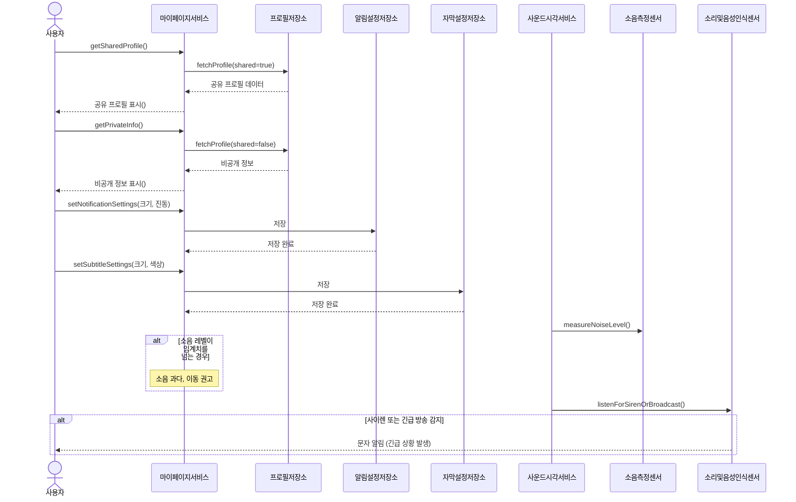

# 마이페이지·자막 설정·소리 알림

[Mermaid 코드](sequence-07-profile-alerts.mmd) · [원본](../sequence.pdf#page=7) · [목록](README.md)

보관 이미지의 요소와 관계를 Mermaid로 복원했습니다. 배치는 자동으로 재구성됩니다.

원본의 `setNotificationSettings` 첫 번째 인자는 `크기`로 읽히며 그대로 옮겼습니다. 설정 의미나 인터페이스를 새로 설계하지 않았습니다.

