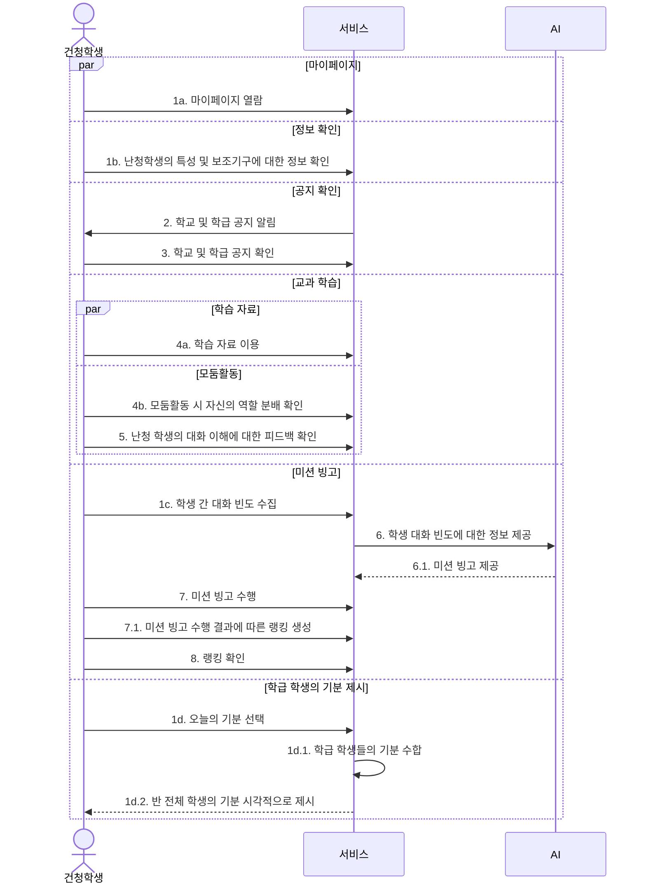

# 건청 학생 학교생활 흐름

[Mermaid 코드](sequence-08-hearing-student.mmd) · [원본](../sequence.pdf#page=8) · [목록](README.md)

보관 이미지의 요소와 관계를 Mermaid로 복원했습니다. 배치는 자동으로 재구성됩니다.

원본의 메시지 번호와 화살표를 유지했습니다. `7.1` 랭킹 생성은 원본에서 학생→서비스 화살표로 표시되어 있습니다.

