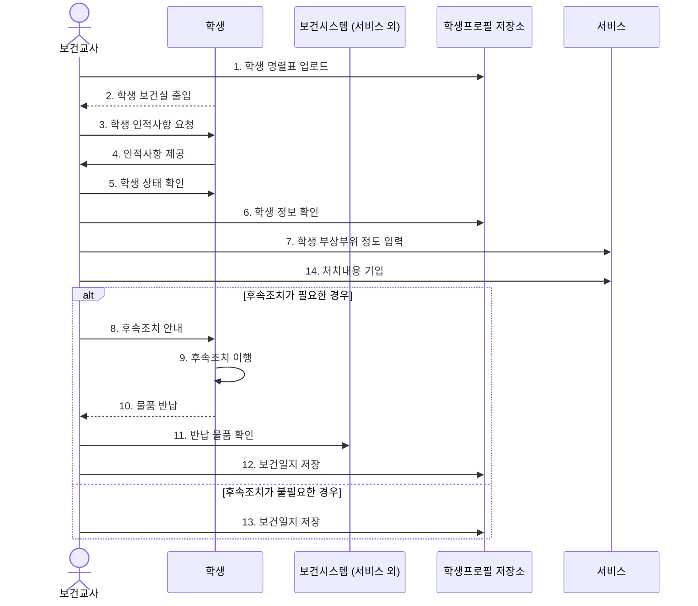

# 보건실 방문·후속조치

[Mermaid 코드](sequence-10-health.mmd) · [원본](../sequence.pdf#page=10) · [목록](README.md)

보관 이미지의 요소와 관계를 Mermaid로 복원했습니다. 배치는 자동으로 재구성됩니다.

원본에서 `14. 처치내용 기입`은 분기 이전에 배치되어 있습니다. 번호 순서나 업무 흐름을 임의로 재배열하지 않았습니다.

